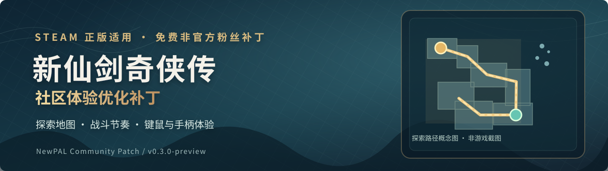

# 《新仙剑奇侠传》Steam 版 · 社区体验优化补丁

**为 Steam 正版《新仙剑奇侠传》增加部分迷宫探索地图，并优化战斗节奏、键鼠和手柄操作、部分养成与画面表现。**

**当前版本：v0.3.0-preview（免费、非官方公开预览版）**

> **[下载玩家补丁 NewPAL_Patch_v0.3.0-preview.zip（约 18.1 MiB）](https://github.com/lihang801290-design/NewPAL-Community-Patch/releases/download/v0.3.0-preview/NewPAL_Patch_v0.3.0-preview.zip)**  
> [完整发布说明](https://github.com/lihang801290-design/NewPAL-Community-Patch/releases/tag/v0.3.0-preview) · [安装与还原](docs/安装与还原.md) · [玩家 FAQ](docs/玩家常见问题.md)

**普通玩家只要下载 NewPAL_Patch 这个 ZIP**。无需 Python，也无需先安装旧补丁。GitHub 的 **Code → Download ZIP 是源码，不是玩家安装包**。

## 功能亮点

| 方向 | 改进 |
| --- | --- |
| **迷宫探索地图** | 部分迷宫支持定位、随移动揭雾及探索进度保存 |
| **战斗节奏** | 战斗进入加快、战后 10 秒保护及设置开关、普通小怪追击范围和速度调整 |
| **操作手感** | 修复部分手柄摇杆、起步和按键问题；改善鼠标八方向行走与跨场景移动 |
| **养成及画面** | HP/MP 上限 9999、战后 6% 恢复、成长与合击调整、部分动画及坏帧修复 |

完整行为和数值请看 [功能与状态](docs/功能与状态.md)。

### 地图系统：实际游戏截图（待维护者补充）

<!-- 实机截图占位 1：上传经过确认的真实游戏画面到 docs/images/gameplay-map.png 后，在此插入 Markdown 图片引用。禁止用概念图冒充实机截图。 -->

> **【图片预留】** 地图窗口、玩家定位和探索揭雾效果。等待维护者提供实际游戏截图。

**当前支持的地图**：梦境罗刹洞、再入罗刹洞前／后、荷花池。其他迷宫仍在开发。`M`／手柄 Back 打开或关闭地图，`Esc`／`B` 关闭，Start 仍打开原游戏主菜单。新增片区名显隐规则已离线检查，最终实机反馈待补。

### 战斗与操作：实际游戏对比（待维护者补充）

<!-- 实机截图占位 2：上传真实对比截图到 docs/images/gameplay-combat.png 后，在此插入 Markdown 图片引用。请注明场景和前后版本。 -->

> **【图片预留】** 战斗或操作优化前后对比。等待维护者提供实际游戏截图或视频。

## 如何安装

1. 准备受支持的 **Steam 正版**游戏，精确 EXE／资源校验见 [baseline.json](baseline.json)。
2. 退出游戏，备份原 EXE、同名资源 PNG 和个人存档。
3. 下载并解压上述 **NewPAL_Patch** 玩家补丁包，把 **EXE 与 Resource 内配套的 111 张 PNG** 一起复制到游戏目录，替换同名文件。
4. 从 Steam 启动游戏。**不要删除原 Resource 文件夹，也不要形成 Resource/Resource 嵌套目录。**

请按 [安装与还原](docs/安装与还原.md) 详细操作；遇到问题可恢复事先备份的原文件。

### 下载页另外两个 ZIP 有什么用？

| 文件 | 用途 |
| --- | --- |
| **NewPAL_Patch_v0.3.0-preview.zip** | **普通玩家安装包，只下载此文件即可** |
| NewPAL_MapTester_v0.3.0-preview.zip | 可选：地图传送／坐标测试工具 |
| NewPAL_MapArtSources_v0.3.0-preview.zip | 可选：地图美术候选素材，**不是已完成的可安装地图** |

发行页附 `SHA256SUMS.txt` 可核对文件完整性，但哈希校验本身不代表软件绝对安全。

## 目前限制与反馈

这是开发中的**预览版**；尚未对全部迷宫、完整剧情和所有手柄设备完成实机测试。地图只覆盖前述片区；实时任务目标及完整出入口指引尚未全面完成。请不要将本版理解为全游戏修复版。

如遇问题，请到 [Issues 反馈](https://github.com/lihang801290-design/NewPAL-Community-Patch/issues/new/choose)，说明游戏版本、补丁版本、具体场景、操作步骤、期望和实际结果。不要上传账号、密钥、私人配置或未经检查的完整日志。常见疑问见 [玩家 FAQ](docs/玩家常见问题.md)。

## 开发者入口

| 事项 | 文档 |
| --- | --- |
| 功能详细说明及验证状态 | [功能与状态](docs/功能与状态.md) |
| AI 协作与贡献代码 | [开发入口](docs/开发入口.md) · [CONTRIBUTING](CONTRIBUTING.md) · [AGENTS](AGENTS.md) |
| 从支持的正版基线重建补丁 | [构建与验证](docs/构建与验证.md) |
| 游戏机制与代码索引 | [知识与模块索引](docs/知识与模块索引.md) |
| 地图制作 | [地图制作规范](docs/地图制作规范.md) |
| 对外宣传与维护 | [社区发布文案](docs/社区发布文案.md) · [发布维护流程](docs/发布维护流程.md) |
| 版本变化 | [CHANGELOG](CHANGELOG.md) |

本项目是**非官方粉丝补丁**，不含游戏本体，不能独立运行。请购买并支持正版。项目自有内容可按 [非商业许可](LICENSE.md) 免费修改和分发，禁止商用售卖；这**不是 MIT 或标准开源许可**。第三方内容保留各自权利，见 [THIRD_PARTY](THIRD_PARTY.md)。

*横幅为原创项目标识图形而非游戏截图；两处游戏效果图保持留空，等待维护者手动替换。*
