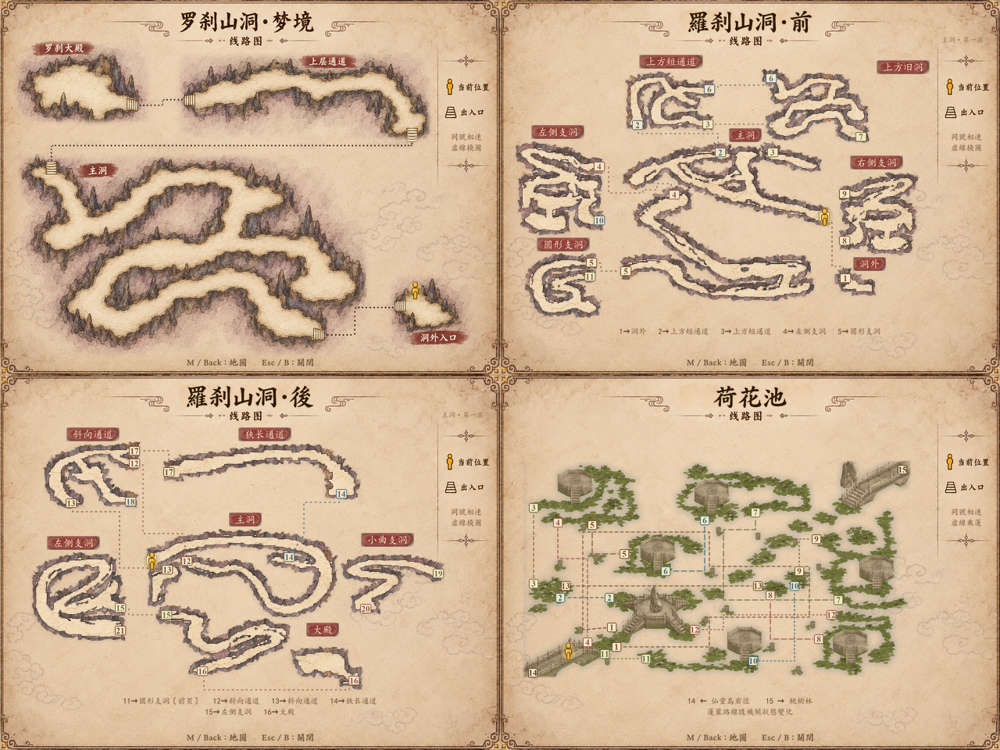
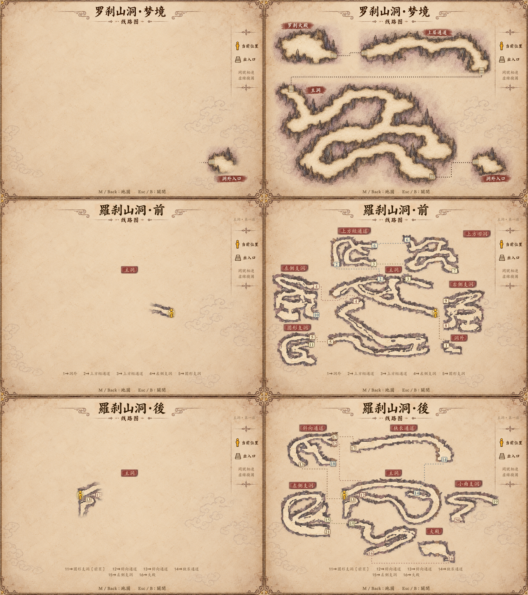

# 《新仙剑奇侠传》Steam 版 · 社区体验优化补丁

<!-- 宣传横幅待替换：维护者准备了保留原作宣传风格的图片，待人工确认并上传 docs/images/classic-banner.jpg 后再引用。请勿使用 AI 生成的游戏操作截图代替实机图。 -->

**给 Steam 正版《新仙剑奇侠传》补上更顺手的操作、较少等待的战斗流程，以及逐步开放的迷宫探索地图。** 这是爱好者维护的非官方修正补丁，目前仍在开发与测试。

**当前发布：v0.3.0-preview（公开预览版）**

> **[下载玩家补丁：NewPAL_Patch_v0.3.0-preview.zip（约 18.1 MiB）](https://github.com/lihang801290-design/NewPAL-Community-Patch/releases/download/v0.3.0-preview/NewPAL_Patch_v0.3.0-preview.zip)**
>
> [查看发布说明和所有附件](https://github.com/lihang801290-design/NewPAL-Community-Patch/releases/tag/v0.3.0-preview) · [安装／还原指南](docs/安装与还原.md) · [玩家常见问题](docs/玩家常见问题.md)

**普通玩家只需下载 `NewPAL_Patch` 安装包。** 无需 Python，不用先安装旧补丁。GitHub 首页 **Code → Download ZIP** 下载的是开发源码，不是可直接覆盖的玩家补丁。

## 本补丁改善了哪些体验？

### 1. 运行稳定性与日常操作

- **Windows 11 下的卡死、闪退问题：** 维护者在自己的环境中遇到过频繁卡死／闪退，并针对该问题进行了修复；**其他 Windows 版本和硬件环境仍需更多玩家验证**，不能保证解决所有闪退。
- **手柄操作：** 修复摇杆移动开始时先慢后快、A／B 键可能连续触发误操作等问题，并补充通用手柄输入链路的相关修正。
- **键盘与鼠标移动：** 处理键盘移动时受到鼠标输入影响而卡顿的问题；按住鼠标左键可更流畅地进行八方向移动，并改善窗口边缘、跨场景继续按住移动的行为。
- **交互提示：** 可交互对象的抓手图标能够在较远位置显示，便于发现目标；**实际可交互距离没有被扩大**。

### 2. 探索时减少无谓追逐和重复遇敌

- **普通地图小怪移动、追击速度降低，追击范围缩小**，走迷宫时不会一直被敌人紧贴着追。剧情中的追逐、飞行、乘莲等脚本运动会单独处理，避免因小怪减速而把过场演出一起拖慢。
- **战斗胜利或逃跑后有 10 秒不遇敌保护**，期间在队角色轻微闪烁作为提示；可以在游戏的系统设置中开关，设置重启后保留。
- **与十里香兼容：** 十里香原生的 60 秒效果期间，不叠加新增的战后保护与闪烁，避免两套机制冲突。

### 3. 战斗主要改的是节奏和反馈

原版进入战斗常需要经历角色停住、遇敌怪叫和黑屏等待。补丁调整进入战斗的时序，让战斗画面与界面更早开始加载，同时保留原本的怪叫与背景音乐衔接，**减少等待而不改变游戏原有战斗画风**。

另外，单次群体攻击消灭多个普通敌人时，死亡演出可同时开始，不再依次等待每只怪物消失；重复声音也会合并处理。还修复了蛇怪向左上方移动时可能出现的异常画面帧。特殊剧情战斗另有兼容处理，奖励仍按原有规则结算。

<!-- 战斗配图待补：上传用户提供的原版战斗截图至 docs/images/original-battle.png 后，在此引用。截图应标为“原游戏战斗画面”，文字介绍补丁的时序与体验改进；不要制作虚假的前后画面对照。 -->

> **战斗画面展示待补：** 这里将放原游戏的战斗截图。优化集中在等待时间、动画衔接和操作反馈，因此不以虚构的“优化后画质截图”宣传。

### 4. 养成数值与战后恢复

- **HP／MP 上限提高至 9999**，同时调整四位数的界面显示。
- **战后恢复：** 每场战斗结束后，仍然存活的在队角色恢复各自上限 **6% 的 HP／MP**；战斗中倒下的角色不会因此复活。
- **随机属性成长：** 保留原本的随机触发概率，**将累计触发所需门槛减半**，让属性成长相对更容易发生。
- **合体攻击：** 在原本的招式目标、动画及差异计算方式基础上增加随成长变化的伤害加成；保留原有 HP 消耗，不额外扣除 MP。

## 新增迷宫探索地图（开发中）

地图系统是目前持续开发的重点。进入已支持的迷宫后，可打开地图查看角色位置；随着角色实际走过的路线逐步揭开迷雾，探索记录会保存，方便找回尚未走过的道路。

**当前覆盖：** 梦境罗刹洞、再入罗刹洞前／后、仙灵岛荷花池。**其他迷宫尚未完成。**

**操作：** 键盘 `M`／手柄 `Back` 打开或关闭地图；`Esc`／`B` 关闭；手柄 `Start` 仍打开游戏原本的主菜单。

*仓库原有的地图系统展示图，已恢复在首页显示；请以实际游戏安装后的效果为准。*

*地图名称显示样式预览。片区名根据实际进入记录显隐的新规则已完成离线检查，最终实机反馈仍待补充。*

**地图开发进度说明：** 目前公开版本配套 **111 张 PNG 资源**。发布附件中的地图美术候选素材用于后续开发，**不代表其中所有迷宫都已经做成可安装地图**。实时任务目标与完整出入口方向提示也尚未全面完成。

## 另附地图传送测试工具（可选）

开发过程中制作了**地图传送器**，供测试人员快速定位场景和复现问题。它支持场景名称搜索、地图图片预览、选择位置并传送，便于检查不同场景的地图数据。使用前需要在游戏中正常读档、连接正在运行的游戏。

传送器的测试用不遇敌行为**不属于普通玩家补丁功能**。测试时请避免存档，结束后重新载入正常存档，以免影响剧情推进。

<!-- 传送器实机截图待补：用户提供的传送器程序界面截图可保存到 docs/images/map-tester.png，再在此处引用。 -->

*工具界面图待补；目前请先查看 [工具说明](docs/工具说明.md)。*

## 安装与下载文件说明

1. 在 Steam 中右键《新仙剑奇侠传》→ **管理 → 浏览本地文件**，找到游戏目录（一般为 `steam/steamapps/common/NewPAL`）。
2. 退出游戏，**先备份原 EXE、可能覆盖的同名 PNG 及存档**。
3. 下载并解压 `NewPAL_Patch_v0.3.0-preview.zip`，按 [安装指南](docs/安装与还原.md) 将包内 **EXE 与 Resource 中配套的 111 张 PNG** 复制到游戏目录，替换同名文件；不要删掉原来的整个 Resource 文件夹，也不要造成 `Resource/Resource` 嵌套。
4. 通过 Steam 启动游戏。如需回退，请按 [还原步骤](docs/安装与还原.md) 恢复备份。

| 下载文件 | 适合谁 | 是否必需 |
| --- | --- | --- |
| **NewPAL_Patch_v0.3.0-preview.zip** | **普通玩家** | **必需，只下载它即可** |
| NewPAL_MapTester_v0.3.0-preview.zip | 地图测试人员 | 可选 |
| NewPAL_MapArtSources_v0.3.0-preview.zip | 地图美术／开发协作者 | 可选，非已完成地图包 |
| SHA256SUMS.txt | 需要校验下载内容的用户 | 可选 |

**兼容性：** 当前面向**受支持的 Steam 正版《新仙剑奇侠传》**；旧 CD 版及其他未验证发行版本不适用。EXE 和素材精确基线见 [baseline.json](baseline.json)。本项目不提供游戏本体。下载文件的 SHA256 可以核对完整性，但不能单独证明软件绝对安全。

## 反馈问题与参与开发

这是一个**预览版**。完整剧情、全部迷宫和不同 Windows／手柄环境尚未全面实测。尤其欢迎报告可稳定复现的崩溃、移动异常或剧情速度问题。

可通过 [GitHub Issues](https://github.com/lihang801290-design/NewPAL-Community-Patch/issues/new/choose) 提交游戏与补丁版本、地图／剧情位置、操作步骤以及预期和实际结果。请勿上传私人账号、访问密钥、未经清理的完整日志或存档。

如果愿意一起开发，本仓库提供现有研究资料、源码入口、工具清单和协作说明；可以使用你熟悉的开发工具继续排查，但请先核对版本基线，并将可复现的改动和验证结果提交给维护者。

| 文档 | 用途 |
| --- | --- |
| [功能与当前状态](docs/功能与状态.md) | 查具体规则、数值与已知限制 |
| [玩家常见问题](docs/玩家常见问题.md) | 安装、兼容、还原及反馈 |
| [开发入口](docs/开发入口.md) · [协作规则](CONTRIBUTING.md) | 开始参与修复 |
| [源码与机制索引](docs/知识与模块索引.md) · [构建与验证](docs/构建与验证.md) | 了解已有成果和重建步骤 |
| [地图制作规范](docs/地图制作规范.md) · [工具说明](docs/工具说明.md) | 制作地图及使用开发工具 |
| [更新记录](CHANGELOG.md) · [社区发布文案](docs/社区发布文案.md) | 查看版本变化和对外介绍 |

本项目是**免费、非官方的玩家补丁**。请购买并支持 Steam 正版；项目自有内容按 [非商业许可](LICENSE.md) 免费使用、修改和分发，禁止商用及售卖补丁；这**不是 MIT 或标准开源许可**。第三方文件与原游戏资源的权利归各自权利人，见 [第三方说明](THIRD_PARTY.md)。
